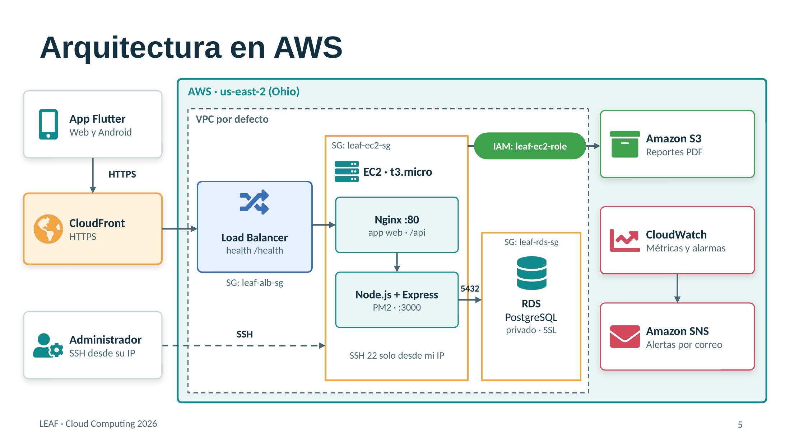

# LEAF — Despliegue en AWS

Proyecto final del curso **Cloud Computing 2026** 

**LEAF** digitaliza la lectura de los contadores de agua de un condominio. El personal de mantenimiento registra las lecturas, el sistema calcula el consumo y los residentes consultan su historial y descargan sus reportes en PDF.

**Aplicación desplegada:** https://d1eik3xsy2bfk4.cloudfront.net

## Arquitectura



Todo el sistema corre en la región **us-east-2 (Ohio)**:

```
Usuario → CloudFront (HTTPS) → Application Load Balancer → EC2 (Nginx → Node.js) → RDS PostgreSQL
                                                                              ↘ S3 (reportes PDF)
```

## Servicios de AWS

| # | Servicio | Uso en LEAF |
|---|---|---|
| 1 | Amazon CloudFront | Puerta de entrada con HTTPS; entrega la app web y reenvía la API al balanceador. |
| 2 | Elastic Load Balancing | Envía el tráfico al servidor solo si responde en `/health`; permite agregar más servidores. |
| 3 | Amazon EC2 | Servidor t3.micro con Ubuntu: Nginx entrega la app web y Node.js con PM2 atiende la API. |
| 4 | Amazon RDS | Base de datos PostgreSQL privada, con conexión SSL y respaldos automáticos. |
| 5 | Amazon S3 | Guarda los reportes PDF; el residente los descarga con un enlace temporal de 5 minutos. |
| 6 | AWS IAM | Rol del servidor con acceso solo a su bucket y usuarios del equipo con permisos mínimos. |
| 7 | Amazon CloudWatch | Alarmas de CPU alta, servidor caído y poco espacio en la base de datos. |
| 8 | Amazon SNS | Envía las alarmas por correo a través del tema `leaf-alertas`. |

## Estructura del repositorio

```
backend/leaf-backend/   API REST en Node.js + Express
frontend/               App en Flutter (web y Android)
diagramas/              Diagramas del sistema
docs/                   Documentación del proyecto
```

## Tecnologías

- **Frontend:** Flutter (web y Android)
- **Backend:** Node.js, Express, JWT, bcrypt, PDFKit, AWS SDK para JavaScript v3
- **Base de datos:** PostgreSQL 18
- **Servidor:** Ubuntu, Nginx, PM2

## Ejecutar el backend

1. Instalar dependencias:

```bash
cd backend/leaf-backend
npm install
```

2. Crear el archivo `.env` a partir de `.env.example` y completar los valores:

```bash
cp .env.example .env
```

| Variable | Descripción |
|---|---|
| `PORT` | Puerto de la API (3000) |
| `DB_HOST`, `DB_PORT`, `DB_NAME`, `DB_USER`, `DB_PASSWORD` | Conexión a PostgreSQL |
| `DB_SSL`, `DB_SSL_CA` | Conexión cifrada a RDS con el certificado `global-bundle.pem` de AWS |
| `JWT_SECRET`, `JWT_EXPIRES_IN` | Firma y duración de los tokens de sesión |
| `AWS_REGION`, `S3_BUCKET` | Región y bucket donde se guardan los reportes PDF |

3. Iniciar la API:

```bash
pm2 start server.js --name leaf-backend
pm2 save
```

Si `S3_BUCKET` no está definido, los reportes se guardan en el disco local; esto permite ejecutar el backend fuera de AWS.

## Compilar la app web

```bash
cd frontend
flutter build web --release --dart-define=API_BASE_URL=
```

Con `API_BASE_URL` vacío, la app usa la misma dirección desde la que se abre, es decir, la de CloudFront. El contenido de `build/web` se copia a `/var/www/leaf` en el servidor y después se invalida la caché de CloudFront con la ruta `/*`.

## Seguridad

- La base de datos no tiene acceso público: solo acepta conexiones del servidor, cifradas con SSL.
- El servidor solo acepta tráfico del balanceador; el acceso SSH está limitado a la IP del administrador.
- El servidor accede a S3 con un rol de IAM, sin llaves guardadas en el código.
- El bucket bloquea todo el acceso público; los PDF se entregan con URLs prefirmadas.
- Las contraseñas de los usuarios se guardan con hash bcrypt, y los secretos viven en `.env`, que no se sube al repositorio.


## Autor

**Pablo Daniel Vásquez Aldana** · 23004631
